# Bikesharing: One Decomposition, Two Model Types

[`glex()`](https://plantedml.com/glex/reference/glex.md) decomposes the
predictions of a tree ensemble into main effects and interaction terms
of any order, and it does so for Random Planted Forests and `xgboost`
alike. This article walks through the same analysis of the bikesharing
data with both, so you can see where the models agree, where they do
not, and what each of them needs from you before
[`glex()`](https://plantedml.com/glex/reference/glex.md) is happy.

The model-specific parts live in tabs. Everything downstream of
[`glex()`](https://plantedml.com/glex/reference/glex.md) is identical.

``` r

library(glex)
library(data.table)
library(ggplot2)
library(patchwork) # To arrange plots
set.seed(2023)
```

## Preparing the Data

The `bike` data shipped with `glex` is a lightly recoded version of the
`Bikeshare` data in the `ISLR2` package, which provides the dataset
published at the [UCI Machine Learning
Repository](https://archive.ics.uci.edu/ml/datasets/bike+sharing+dataset).

> This data set contains the hourly and daily count of rental bikes
> between years 2011 and 2012 in Capital bikeshare system, along with
> weather and seasonal information.

The outcome is `bikers`, the total number of bikers in the system. The
predictors of interest are

- `hr`: Hour of day, 0 to 23 hours.
- `temp`: Normalized temperature in Celsius.
- `workingday`: Whether it is a work day or not.
- `hum`: Normalized humidity.
- `weathersit`: Weather situation, from `clear` to `light rain/snow`.
- `season`: Winter, Spring, Summer, Fall.

``` r

data(bike, package = "glex")

# Only one observation with this condition, removing it to make space.
bike <- bike[weathersit != "heavy rain/snow", ]
bike[, weathersit := droplevels(weathersit)]

vars <- c("hr", "temp", "workingday", "hum", "weathersit", "season")
x <- as.data.frame(bike[, ..vars])

str(x)
#> 'data.frame':    8644 obs. of  6 variables:
#>  $ hr        : num  0 1 2 3 4 5 6 7 8 9 ...
#>  $ temp      : num  0.24 0.22 0.22 0.24 0.24 0.24 0.22 0.2 0.24 0.32 ...
#>  $ workingday: Factor w/ 2 levels "No Workingday",..: 1 1 1 1 1 1 1 1 1 1 ...
#>  $ hum       : num  0.81 0.8 0.8 0.75 0.75 0.75 0.8 0.86 0.75 0.76 ...
#>  $ weathersit: Factor w/ 3 levels "clear","cloudy/misty",..: 1 1 1 1 1 2 1 1 1 1 ...
#>  $ season    : Factor w/ 4 levels "Winter","Spring",..: 1 1 1 1 1 1 1 1 1 1 ...
```

`workingday`, `weathersit` and `season` are factors, which both model
types take as they are.

## Fitting the Models

Each tab fits one model, hands it to
[`glex()`](https://plantedml.com/glex/reference/glex.md) and stores the
result in `components`. With the settings below, fitting and decomposing
both takes about a minute in total.

- `components`` ``<-`` `[`list`](https://rdrr.io/r/base/list.html)`(``)`` ``labels`` ``<-`` `[`c`](https://rdrr.io/r/base/c.html)`(``rpf ``=`` ``"Random Planted Forest"``, xgboost ``=`` ``"xgboost"``)`
- Random Planted Forest
- xgboost

We limit the model’s complexity with `max_interaction = 3`, as we are
only going to visualize interactions up to the third degree, and a
higher value would only marginally improve predictive performance at the
cost of a longer runtime. A model with 50 tree families suffices here.
[`rpf()`](https://plantedml.com/randomPlantedForest/reference/rpf.html)
fits the forest and keeps the few of its components that matter, each
refitted with one coefficient (see
[`randomPlantedForest::prune_components()`](https://plantedml.com/randomPlantedForest/reference/prune_components.html)).
These components are the model, so
[`glex()`](https://plantedml.com/glex/reference/glex.md) takes them as
they are.

``` r

library(randomPlantedForest)

rp <- rpf(
  bikers ~ hr + temp + workingday + hum + weathersit + season,
  data = bike,
  max_interaction = 3,
  n_families = 50,
  n_splits = 100,
  share_candidates = 0.9,
  n_try_split_points = 5
)

components$rpf <- glex(rp, bike)
```

Having few components, the model can be drawn whole:
[`plot()`](https://rdrr.io/r/graphics/plot.default.html) without
predictors shows its components as the model predicts with them, the
largest first, each titled by its share of the variance of the
prediction; `max_components` keeps the plot to the largest.

``` r

plot(components$rpf, max_components = 6)
```

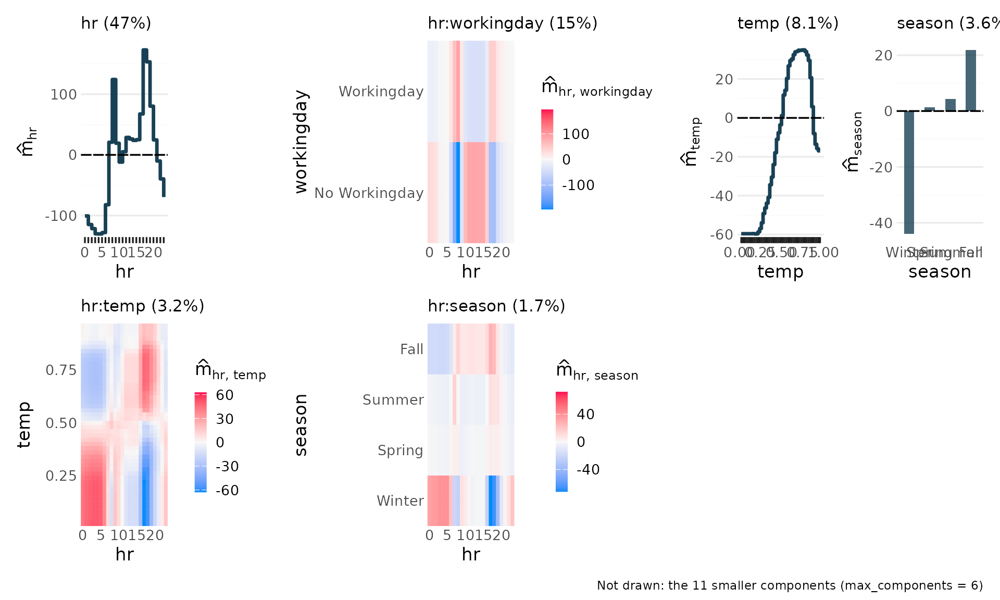

Since `xgboost` 3.0, a `data.frame` with factor columns is accepted
directly and the trees split on sets of levels, so no dummy encoding is
needed. [`glex()`](https://plantedml.com/glex/reference/glex.md) reads
those categorical splits and keeps the factors for plotting; pass the
same `data.frame` to both. The interaction order is determined by
`max_depth`.

The parameters below are placeholders. Replace them with tuned values.

``` r

library(xgboost)

xg <- xgboost(
  x,
  bike$bikers,
  nrounds = 100,
  max_depth = 4,
  learning_rate = 0.1,
  nthreads = 2,
  verbosity = 0
)

components$xgboost <- glex(xg, x)
```

## What `glex()` Returns

Every `glex` object holds the decomposition `m` (one column per term),
the SHAP values derived from it and the data `x` used for plotting. The
number of terms differs by model: for `xgboost` a term exists for every
feature subset the model splits on together, for the Random Planted
Forest only for the components it keeps:

``` r

sapply(components, function(gl) ncol(gl$m))
#>     rpf xgboost 
#>      17      63
```

Variable importances summarize the average absolute contribution of each
term. Here are the top terms per model:

``` r

lapply(components, function(gl) head(glex_vi(gl), 6))
#> $rpf
#>    degree          term        m     m_rel
#>     <int>        <char>    <num>     <num>
#> 1:      1            hr 70.84490 0.5022735
#> 2:      2 hr:workingday 34.21013 0.2425416
#> 3:      1          temp 32.75844 0.2322495
#> 4:      2       hr:temp 17.69695 0.1254671
#> 5:      1        season 17.36409 0.1231073
#> 6:      1           hum 11.78024 0.0835191
#> 
#> $xgboost
#>    degree          term        m     m_rel
#>     <int>        <char>    <num>     <num>
#> 1:      1            hr 70.73483 0.4918541
#> 2:      1          temp 31.71445 0.2205262
#> 3:      2 hr:workingday 28.09030 0.1953257
#> 4:      2       hr:temp 18.54844 0.1289764
#> 5:      1        season 18.39189 0.1278879
#> 6:      1           hum 11.54984 0.0803117
```

From here on, every section applies the same code to each model. The
helper below prints one tab per model.

``` r

tabs <- function(plot_fun) {
  for (model in names(components)) {
    cat("\n\n### ", labels[[model]], "\n\n", sep = "")
    print(plot_fun(components[[model]]))
    cat("\n\n")
  }
}
```

## Main Effects

- `tabs``(``function``(``gl``)`` ``{`` `` `[`plot_main_effect`](https://plantedml.com/glex/reference/plot_components.md)`(``gl``, ``"temp"``)`` ``+`` `` `[`plot_main_effect`](https://plantedml.com/glex/reference/plot_components.md)`(``gl``, ``"hr"``)`` ``+`` `` `[`plot_main_effect`](https://plantedml.com/glex/reference/plot_components.md)`(``gl``, ``"season"``)`` ``+`` `` `[`plot_layout`](https://patchwork.data-imaginist.com/reference/plot_layout.html)`(``widths ``=`` `[`c`](https://rdrr.io/r/base/c.html)`(``.3``, ``.3``, ``.4``)``)`` ``}``)`
- Random Planted Forest
- xgboost

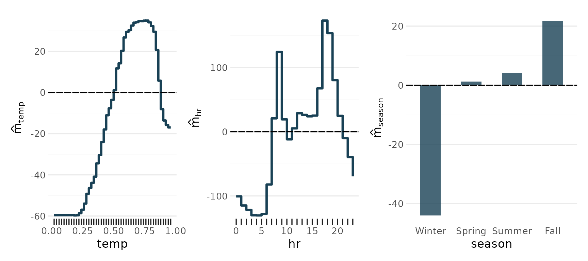

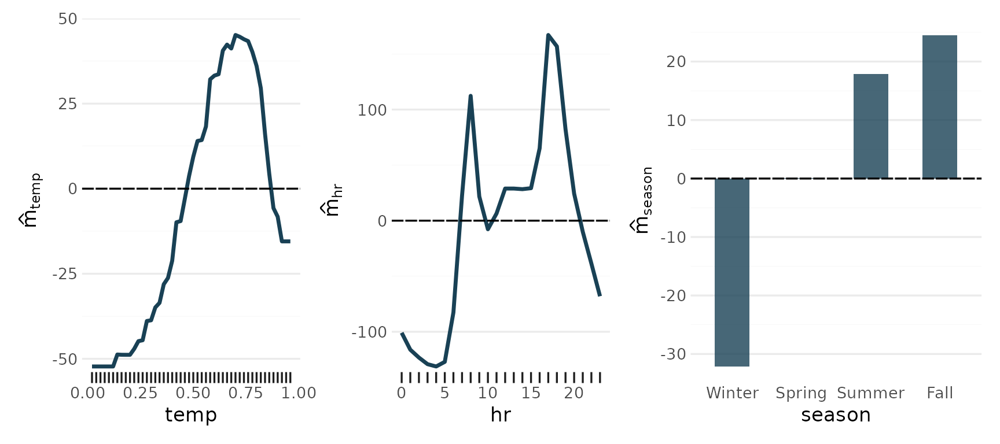

## 2-Way Interactions

- `tabs``(``function``(``gl``)`` ``{`` `` ``p_2way1`` ``<-`` `[`plot_twoway_effects`](https://plantedml.com/glex/reference/plot_components.md)`(``gl``, `[`c`](https://rdrr.io/r/base/c.html)`(``"workingday"``, ``"temp"``)``)`` `` ``p_2way2`` ``<-`` `[`plot_twoway_effects`](https://plantedml.com/glex/reference/plot_components.md)`(``gl``, `[`c`](https://rdrr.io/r/base/c.html)`(``"hr"``, ``"workingday"``)``)`` `` ``p_2way3`` ``<-`` `[`plot_twoway_effects`](https://plantedml.com/glex/reference/plot_components.md)`(``gl``, `[`c`](https://rdrr.io/r/base/c.html)`(``"hr"``, ``"temp"``)``)`` `` `` ``p_2way`` ``<-`` ``(``p_2way1`` ``/`` ``p_2way2`` ``+`` `[`plot_layout`](https://patchwork.data-imaginist.com/reference/plot_layout.html)`(``guides ``=`` ``"collect"``)`` ``&`` `[`theme`](https://ggplot2.tidyverse.org/reference/theme.html)`(``legend.position ``=`` ``"bottom"``)``)`` ``|`` ``p_2way3`` `` `` ``p_2way`` ``+`` `` `[`plot_annotation`](https://patchwork.data-imaginist.com/reference/plot_annotation.html)`(``tag_levels ``=`` `[`list`](https://rdrr.io/r/base/list.html)`(`[`c`](https://rdrr.io/r/base/c.html)`(``"1,2"``, ``"3,1"``, ``"3,3"``)``)``, tag_prefix ``=`` ``"m("``, tag_suffix ``=`` ``")"``)`` ``}``)`
- Random Planted Forest
- xgboost

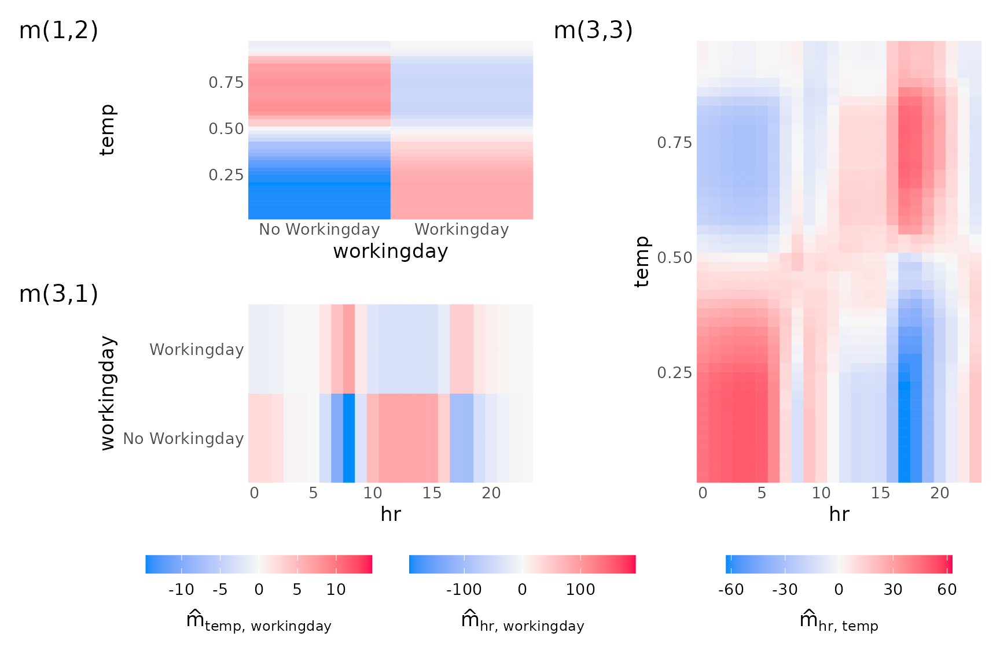

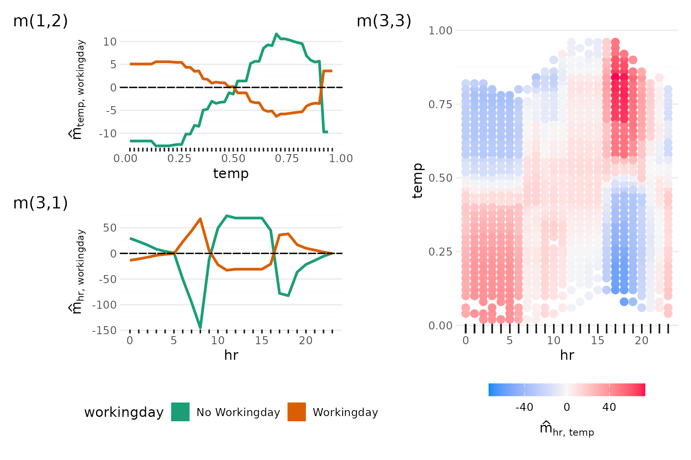

## 3-Way Interaction

The Random Planted Forest’s component of three predictors is drawn as
heat maps over two of them, one per cell of the third.

- `tabs``(``function``(``gl``)`` `[`plot_threeway_effects`](https://plantedml.com/glex/reference/plot_components.md)`(``gl``, `[`c`](https://rdrr.io/r/base/c.html)`(``"hr"``, ``"temp"``, ``"workingday"``)``)``)`
- Random Planted Forest
- xgboost

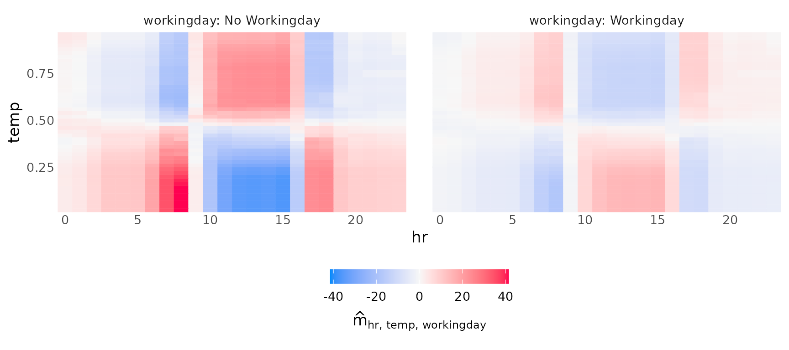


## Side by Side

The tabs make it easy to inspect one model at a time. To compare them,
the same term from both models goes into one figure. The `hr` by
`workingday` interaction is the most striking one in this data: on
working days the commuting peaks appear, on other days the afternoon
dominates.

``` r

wrap_plots(
  lapply(names(components), function(model) {
    plot_twoway_effects(components[[model]], c("hr", "workingday")) +
      ggtitle(labels[[model]])
  }),
  guides = "collect"
) & theme(legend.position = "bottom")
```

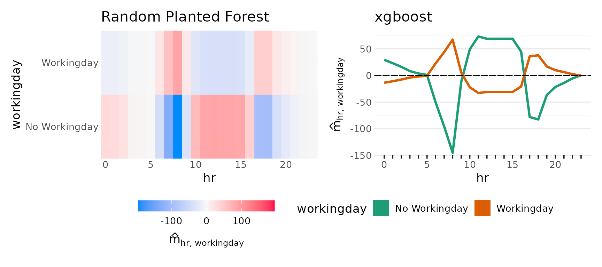

The same for the `temp` main effect, where the smoothness of the two
model types differs the most:

``` r

wrap_plots(lapply(names(components), function(model) {
  plot_main_effect(components[[model]], "temp") + ggtitle(labels[[model]])
}))
```

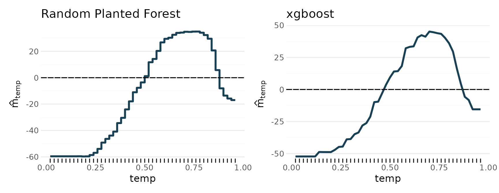

## Additional Effects

All main effects, by iterating over the predictors in `vars` (hr, temp,
workingday, hum, weathersit, season) that have one and collecting the
plots with
[`patchwork::wrap_plots()`](https://patchwork.data-imaginist.com/reference/wrap_plots.html).
The Random Planted Forest has no main effect of `workingday`: in it,
working days matter only through interactions, above all the one with
the hour.

- `tabs``(``function``(``gl``)`` `[`wrap_plots`](https://patchwork.data-imaginist.com/reference/wrap_plots.html)`(`[`lapply`](https://rdrr.io/r/base/lapply.html)`(`[`intersect`](https://rdrr.io/r/base/sets.html)`(``vars``, `[`names`](https://rdrr.io/r/base/names.html)`(``gl``$``m``)``)``, ``plot_main_effect``, object ``=`` ``gl``)``)``)`
- Random Planted Forest
- xgboost

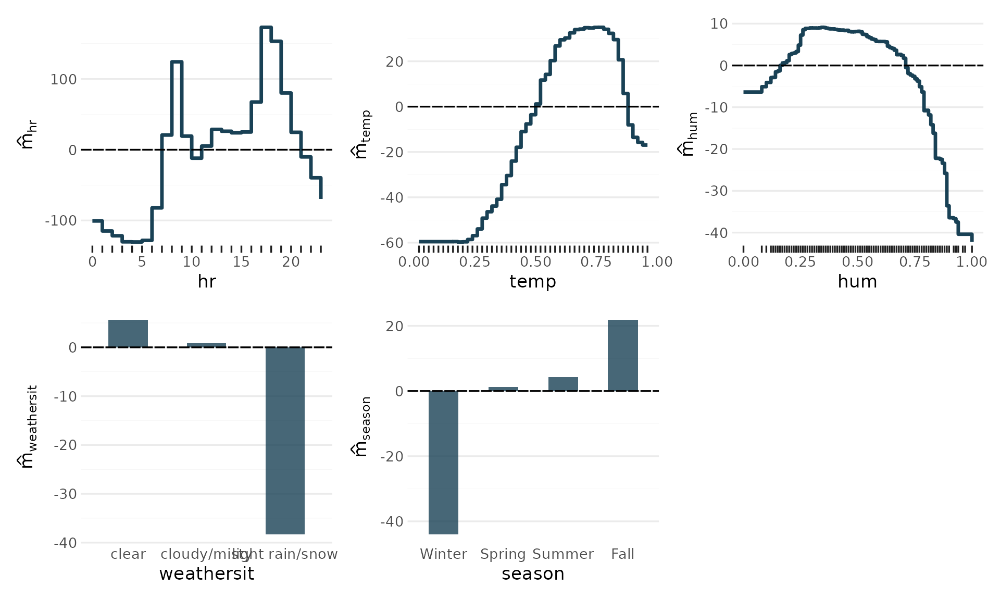

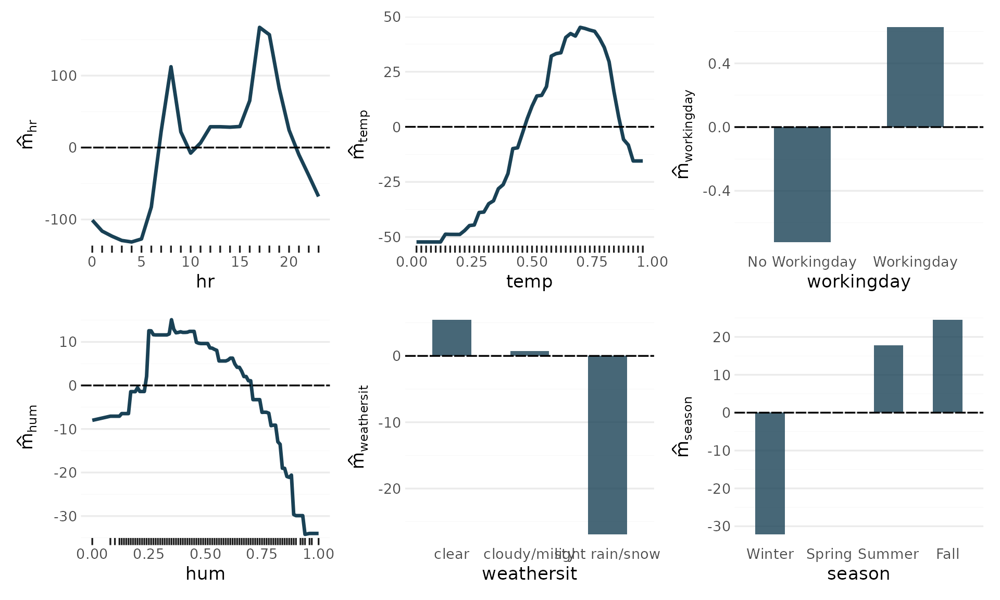

## More Interactions

[`plot()`](https://rdrr.io/r/graphics/plot.default.html) passes its
arguments on to the specialized `plot_*` functions, depending on the
number of predictors supplied. Third degree interactions can be tricky
to interpret, if they have any effect at all.

- `tabs``(``function``(``gl``)`` ``{`` `` ``(`[`plot`](https://rdrr.io/r/graphics/plot.default.html)`(``gl``, `[`c`](https://rdrr.io/r/base/c.html)`(``"season"``, ``"temp"``)``)`` ``|`` `[`plot`](https://rdrr.io/r/graphics/plot.default.html)`(``gl``, `[`c`](https://rdrr.io/r/base/c.html)`(``"season"``, ``"hr"``)``)``)`` ``/`` `` ``(`[`plot`](https://rdrr.io/r/graphics/plot.default.html)`(``gl``, `[`c`](https://rdrr.io/r/base/c.html)`(``"weathersit"``, ``"hr"``)``)`` ``|`` `[`plot`](https://rdrr.io/r/graphics/plot.default.html)`(``gl``, `[`c`](https://rdrr.io/r/base/c.html)`(``"hum"``, ``"temp"``)``)``)`` ``/`` `` `[`plot`](https://rdrr.io/r/graphics/plot.default.html)`(``gl``, `[`c`](https://rdrr.io/r/base/c.html)`(``"workingday"``, ``"hr"``, ``"season"``)``)`` ``}``)`
- Random Planted Forest
- xgboost

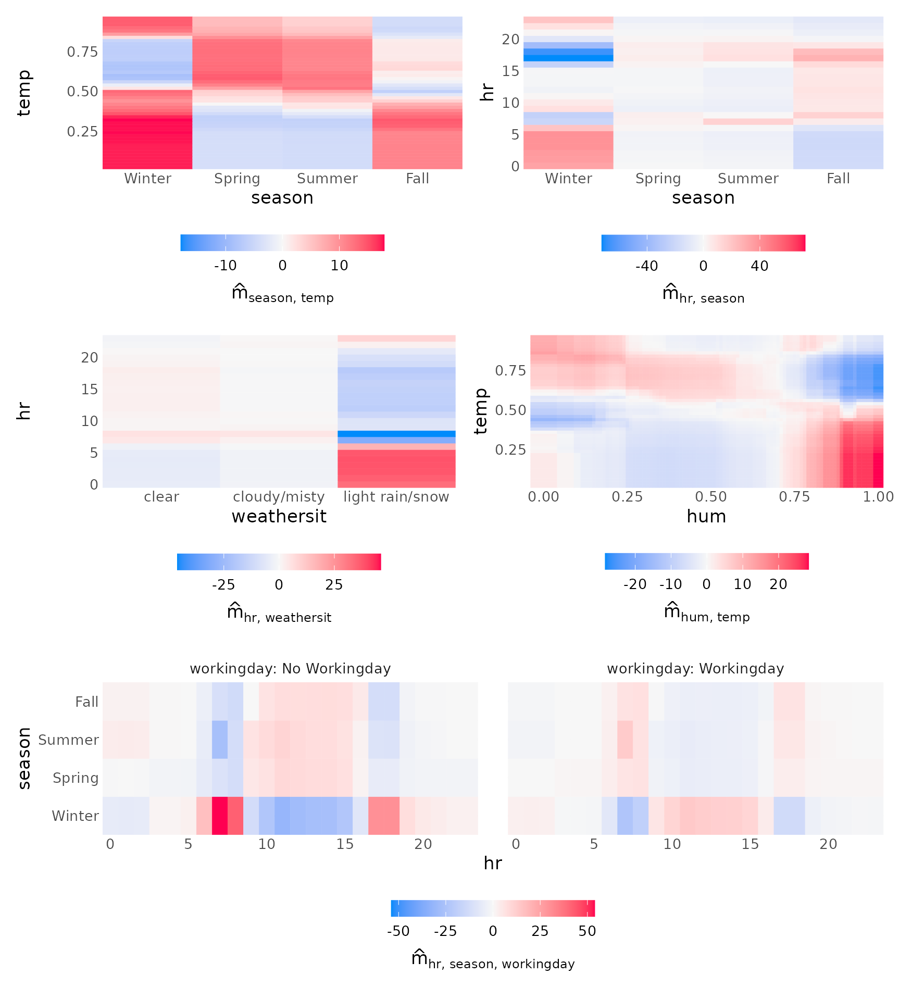

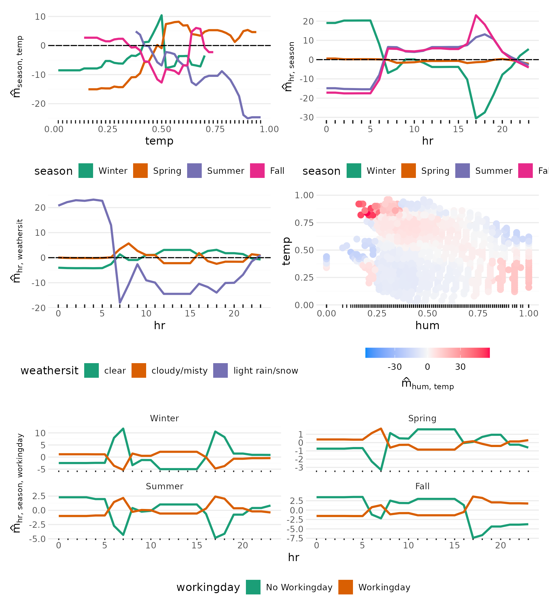

## One Prediction

The terms of one prediction, from the intercept to the model’s
prediction, the largest first:

- `tabs``(``function``(``gl``)`` `[`plot_waterfall`](https://plantedml.com/glex/reference/plot_waterfall.md)`(``gl``, id ``=`` ``1``)``)`
- Random Planted Forest
- xgboost

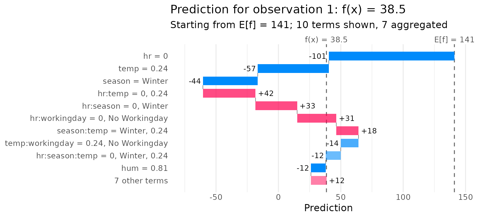

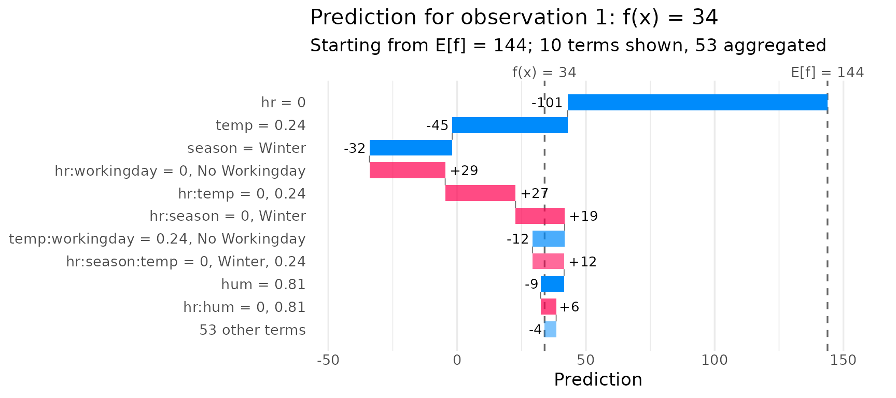
